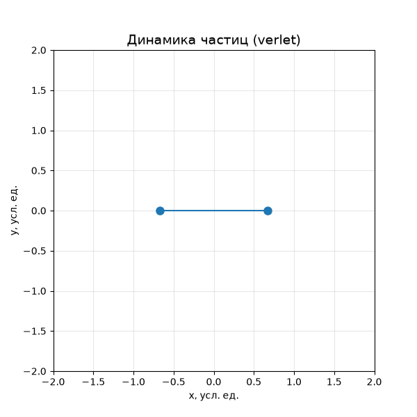
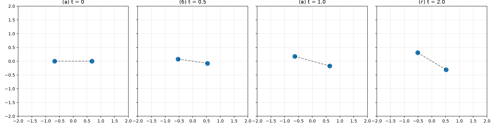

# ЛР №2. Моделирование парного взаимодействия двух частиц



---

## 📖 О проекте

Данный репозиторий содержит компьютерную модель движения двух частиц в двумерном пространстве, взаимодействующих посредством потенциала Леннарда–Джонса. 

**Цель работы** — сравнить точность двух численных методов интегрирования (явного метода Эйлера и метода velocity-Verlet) по величине дрейфа полной механической энергии системы.

**Ключевой результат:** метод velocity-Verlet сохраняет энергию примерно на 4 порядка точнее (относительная ошибка $\approx 10^{-4}$) по сравнению с методом Эйлера ($\approx 10^0$) при одинаковом шаге времени.

---

## 🧮 Физическая модель

Система состоит из двух одинаковых частиц массы ($m = 1$). Потенциальная энергия взаимодействия задаётся потенциалом Леннарда–Джонса:

$$
U(r) = 4\varepsilon \left[ \left(\frac{\sigma}{r}\right)^{12} - \left(\frac{\sigma}{r}\right)^6 \right]
$$

Сила взаимодействия:

$$
\mathbf{F}_{12} = 24\varepsilon \left( 2\frac{\sigma^{12}}{r^{13}} - \frac{\sigma^6}{r^7} \right) \frac{\mathbf{r}_{12}}{r}
$$

Полная энергия системы:

$$
E = \sum_i \frac{m |\mathbf{v}_i|^2}{2} + U(r)
$$

Все величины безразмерные: ($m = \varepsilon = \sigma = 1$). В изолированной системе полная энергия должна сохраняться. Численная схема вносит погрешность — по её величине и сравниваются методы.

---

## ⚙️ Установка и запуск

### Шаг 1. Установка зависимостей
Откройте терминал в папке проекта и выполните команду:

```bash
python -m pip install -r requirements.txt
```

### Шаг 2. Базовый запуск
Запуск модели с параметрами по умолчанию (5000 шагов, шаг времени 0.002):

```bash
python main.py
```

После этого в папке `results/` появятся:
* `trajectories.png` — траектории частиц (метод velocity-Verlet);
* `trajectories_euler.png` — траектории частиц (метод Эйлера);
* `energy_error.png` — график относительной ошибки энергии;
* `energy_history.csv` — числовые данные по энергиям;
* `summary.txt` — краткая сводка результатов.

### Шаг 3. Генерация анимации
Чтобы создать GIF-анимацию и снапшоты, выполните:

```bash
python make_gif.py
```

Скрипт создаст файлы `particle_dynamics.gif` и `evolution_snapshots.png` в корневой папке.

---

## 🖥 Интерфейс командной строки (CLI)

Модель поддерживает настройку параметров через именованные аргументы. Пример запуска с нестандартными параметрами:

```bash
python main.py --steps 10000 --dt 0.001 --distance 1.35 --speed 0.15 --out my_results
```

| Опция | Тип | По умолчанию | Описание |
|-------|-----|--------------|----------|
| `--steps` | int | 5000 | Число шагов интегрирования |
| `--dt` | float | 0.002 | Шаг времени |
| `--distance` | float | 1.35 | Начальное расстояние между частицами |
| `--speed` | float | 0.15 | Модуль начальной скорости каждой частицы |
| `--out` | path | results | Каталог для сохранения графиков и CSV |

Для просмотра справки по всем опциям используйте:

```bash
python main.py --help
```

---

## 🧪 Тестирование

Код покрыт модульными тестами (библиотека `pytest`). Запуск тестов:

```bash
python -m pytest -v
```

**Реализованные тесты (все 7 проходят успешно):**
1. `test_newton_third_law` — проверка третьего закона Ньютона (силы равны и противоположны);
2. `test_lj_potential_minimum` — проверка минимума потенциала ($r = 2^{1/6}\sigma$, $U = -\varepsilon$);
3. `test_energy_is_finite` — энергия конечна на всех шагах;
4. `test_verlet_has_better_energy_behavior_than_euler` — velocity-Verlet точнее по энергии;
5. `test_shapes` — корректность форм массивов;
6. `test_invalid_method` — обработка неверного метода интегрирования;
7. `test_coincident_particles_rejected` — обработка совпадающих координат.

---

## 📊 Результаты экспериментов

| Метод | Начальная энергия $E_0$ | Макс. абсолютный дрейф | Относительная ошибка |
|-------|-------------------------|------------------------|----------------------|
| Эйлер | −0.529123 | 0.577856 | $\approx 1.09$ (109%) |
| Velocity-Verlet | −0.529123 | $5.65 \times 10^{-5}$ | $\approx 1.07 \times 10^{-4}$ |

**Снапшоты эволюции системы (метод velocity-Verlet):**



---

## 🗂 Структура проекта

```text
LR2_particles_dynamics/
├── particle_model.py          # Физическая модель: сила, энергия, интеграторы
├── main.py                    # CLI, проведение экспериментов, графики
├── make_gif.py                # Генерация GIF-анимации и снапшотов
├── tests/
│   └── test_particle_model.py # Модульные тесты (pytest)
├── requirements.txt           # Зависимости проекта
├── pytest.ini                 # Настройка pytest
├── README.md                  # Документация (этот файл)
├── .gitignore                 # Исключения для Git
├── particle_dynamics.gif      # Анимация для README
└── evolution_snapshots.png    # Снапшоты для отчёта и README
```

---

## 📚 Источники

1. Allen M. P., Tildesley D. J. *Computer Simulation of Liquids*. 2nd ed. Oxford University Press, 2017.
2. Frenkel D., Smit B. *Understanding Molecular Simulation: From Algorithms to Applications*. 2nd ed. Academic Press, 2002.
3. Хайрер Э., Нёрсетт С., Ваннер Г. *Решение обыкновенных дифференциальных уравнений*. — М.: Мир, 1990.
4. Verlet L. *Computer «Experiments» on Classical Fluids* // Physical Review. 1967. Vol. 159, No. 1. P. 98–103.

---

